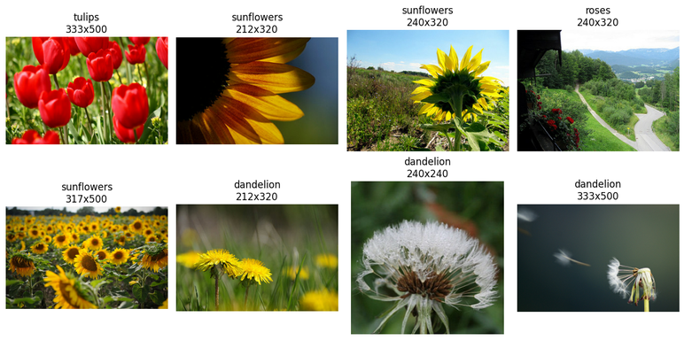
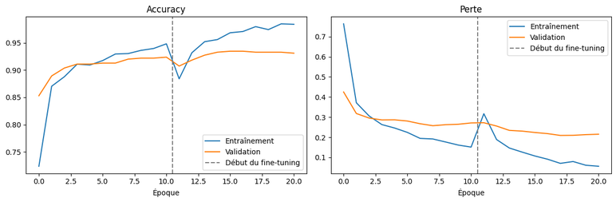
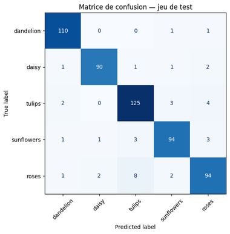
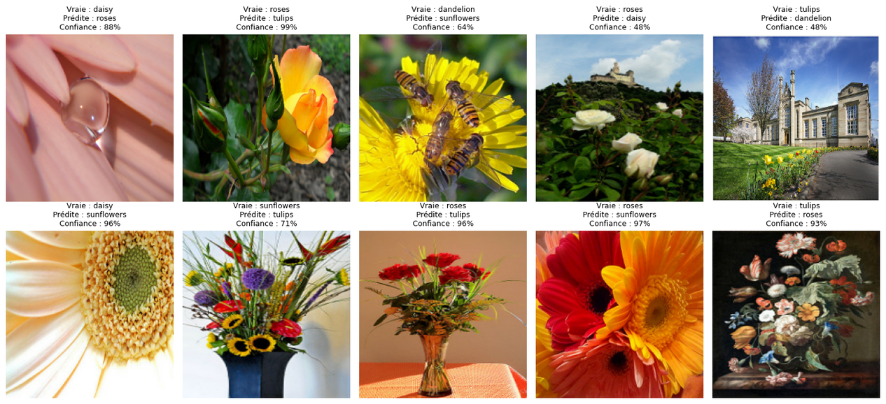

# Classification de fleurs par transfer learning (ResNet50)

Reconnaître automatiquement l'espèce d'une fleur sur une photo, parmi 5 catégories (pissenlit, marguerite, tulipe, tournesol, rose), en réutilisant un réseau de neurones convolutif pré-entraîné.

**Résultats clés sur le jeu de test (550 photos jamais vues) :**
* **Accuracy :** 93,3 % (513 / 550)
* **Rappel minimal par classe :** 88 % (roses)
* **Score de test identique à la validation** (93,3 %) : le modèle généralise bien

[Consulter le notebook complet](Classification_fleurs_transfer_learning_ResNet50.ipynb)

---

## Contexte et enjeu

* **Problématique :** classification d'images multi-classes (5 classes), apprentissage supervisé.
* **Données :** jeu `tf_flowers` (TensorFlow Datasets), **3 670 photos** en couleur, de tailles variées, réparties de façon à peu près équilibrée entre les 5 classes.
* **Difficulté :** 3 670 images, c'est trop peu pour entraîner de zéro un réseau profond de plusieurs millions de paramètres sans surapprentissage. D'où le choix du **transfer learning**.

## Méthodologie

1. **Découpage des données :** entraînement 70 % / validation 15 % / test 15 %. Le jeu de test n'est utilisé qu'une seule fois, à la fin.
2. **Préparation :** redimensionnement en 224 × 224 pixels et prétraitement propre à ResNet50 (`preprocess_input`), dans un pipeline `tf.data` (mélange, lots de 32, préchargement).
3. **Phase 1 – Extraction de caractéristiques :** **ResNet50** pré-entraîné sur **ImageNet**, gelé, surmonté d'une nouvelle tête de classification (`GlobalAveragePooling2D` → `Dropout(0.2)` → `Dense(5, softmax)`). Seuls **10 245 paramètres** sont entraînés (Adam, learning rate 0,001).
4. **Lutte contre le surapprentissage :** **augmentation de données** (retournement, rotation, zoom), **dropout** et **arrêt anticipé** sur la perte de validation.
5. **Phase 2 – Fine-tuning :** dégel des 30 dernières couches de ResNet50 (**14,5 millions de paramètres** entraînables) avec un learning rate 100 fois plus faible (1e-5), pour adapter le réseau aux fleurs sans effacer ce qu'il a appris sur ImageNet.
6. **Évaluation et analyse des erreurs :** accuracy, précision / rappel par classe, matrice de confusion, inspection visuelle des photos mal classées.

## Résultats

### Courbes d'apprentissage

| Étape | Accuracy en validation |
| :--- | :---: |
| Phase 1 : tête seule (ResNet50 gelé) | 92,0 % |
| Phase 2 : après fine-tuning | **93,3 %** |

Le fine-tuning apporte environ **1,3 point** et fait baisser la perte de validation (de 0,257 à 0,209). L'écart croissant entre entraînement et validation signale un surapprentissage modéré, maîtrisé par l'arrêt anticipé, qui conserve les meilleurs poids.

### Performances sur le jeu de test

| Classe | Précision | Rappel |
| :--- | :---: | :---: |
| Pissenlit | 0,96 | 0,98 |
| Marguerite | 0,97 | 0,95 |
| Tulipe | 0,91 | 0,93 |
| Tournesol | 0,93 | 0,92 |
| Rose | 0,90 | 0,88 |

La confusion principale concerne les **roses et les tulipes** (8 roses prédites tulipes), deux fleurs aux couleurs et aux formes de pétales proches.

### Analyse des erreurs

Les erreurs ne sont pas toutes des fautes du modèle :
* **Étiquettes discutables :** des gerberas étiquetées « roses ».
* **Images ambiguës :** bouquets mélangeant plusieurs espèces, peinture, fleurs minuscules dans un paysage, gros plans partiels.
* **Confiance trompeuse :** certaines erreurs sont faites avec 96 à 99 % de confiance, ce qui montre que les probabilités du softmax ne mesurent pas parfaitement la certitude du modèle.

## Limites et pistes d'amélioration

* Nettoyer les étiquettes erronées du jeu de données.
* Ajouter des exemples de roses et de tulipes, la paire la plus confondue.
* Tester des architectures plus récentes (EfficientNet, par exemple).
* Calibrer les probabilités pour que la confiance affichée reflète mieux la fiabilité réelle.

**Application possible :** la même démarche s'applique au **contrôle qualité visuel** en industrie (détection de défauts sur des pièces à partir de photos), où les images annotées sont souvent peu nombreuses.

## Stack technique

`Python` · `TensorFlow / Keras` · `TensorFlow Datasets` · `Scikit-learn` · `NumPy` · `Matplotlib` · `Google Colab (GPU T4)`

---
*Projet réalisé par Ndeye Maimouna Badiane — Élève ingénieure en Mathématiques Appliquées et Modélisation (Polytech Lyon).*
